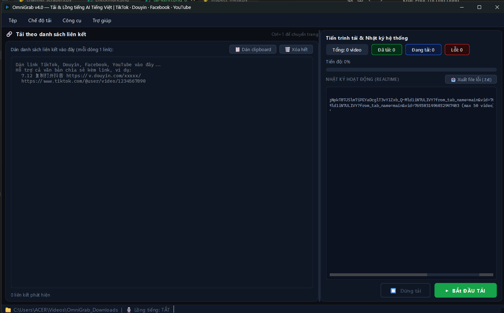
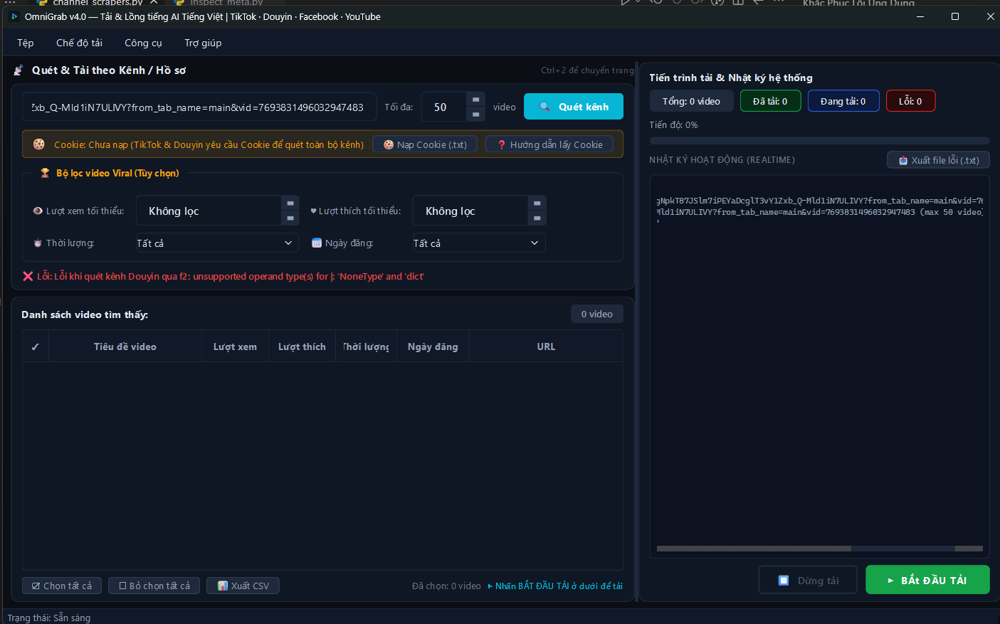

<div align="center">
  
  <h1>OmniGrab</h1>
  <p><strong>Công cụ desktop để tải, duyệt và xử lý video</strong></p>
  <p>TikTok · Douyin · Facebook · YouTube</p>
  <p>PyQt6 · yt-dlp · FFmpeg · faster-whisper</p>
</div>

---

## OmniGrab là gì?

OmniGrab là ứng dụng desktop Python có giao diện tiếng Việt, tập trung vào quy trình làm việc với video:

1. Nhập một hoặc nhiều liên kết, tải chúng về thư mục cục bộ và theo dõi từng tác vụ.
2. Quét danh sách video từ một số loại kênh/trang, xem metadata, lọc rồi chọn video cần tải.
3. Mở video trong Studio để nhận dạng lời thoại, dịch, hiệu chỉnh kịch bản, xuất phụ đề hoặc tạo bản lồng tiếng.
4. Có thể cấu hình quy trình đăng video lên TikTok hoặc YouTube Studio sau khi tải/lồng tiếng.

Các nền tảng thay đổi API, giới hạn truy cập và cấu trúc trang thường xuyên. Vì vậy, việc hỗ trợ một loại URL không đảm bảo mọi video, tài khoản hoặc khu vực đều truy cập được. Hãy dùng cookie của tài khoản có quyền xem nội dung và tuân thủ luật bản quyền cùng điều khoản của nền tảng.

## Tính năng

### Tải theo danh sách liên kết

- Trích URL TikTok, Douyin, Facebook và YouTube từ văn bản thường, tin nhắn chia sẻ hoặc file `.txt`/`.csv`.
- Chuẩn hóa một số liên kết, loại URL trùng và giữ thứ tự xuất hiện.
- Tải nhiều URL đồng thời bằng worker nền; số luồng được cấu hình trong ứng dụng.
- Hỗ trợ cookie dạng Netscape khi video cần phiên đăng nhập.
- Có chế độ chỉ lấy âm thanh MP3 (192 kbps qua FFmpeg/yt-dlp).
- Có tiếp tục tải dở theo cơ chế của yt-dlp khi extractor và máy chủ hỗ trợ.
- Theo dõi tiến trình, log, kết quả từng URL và xuất danh sách URL thất bại.

Định dạng, chất lượng và tên file cuối phụ thuộc extractor, định dạng do nền tảng cung cấp, tùy chọn yt-dlp và FFmpeg. Với một số downloader, OmniGrab ưu tiên MP4 và codec tương thích; nếu phát hiện video HEVC trong nhánh xử lý hỗ trợ, ứng dụng thử chuyển video sang H.264. Việc chuyển mã cần thêm thời gian và dung lượng trống. Khi FFmpeg hoặc FFprobe không có, một số thao tác hậu kỳ có thể không hoạt động.

### Quét kênh và chọn video

- **YouTube/TikTok và các playlist extractor hỗ trợ:** lấy danh sách bằng yt-dlp ở chế độ trích xuất nhanh.
- **Douyin:** scraper riêng gọi endpoint web/API và dùng thành phần `f2` cho một số dữ liệu/ký hiệu API. Kết quả phụ thuộc endpoint, phiên truy cập và thay đổi từ Douyin.
- **Facebook:** scraper riêng phân tích dữ liệu trang và có thể dùng cookie để thử đường truy cập bổ sung. Trang đăng nhập, riêng tư hoặc bị giới hạn có thể không quét được.
- Chọn **All** để tiếp tục phân trang đến khi nguồn không trả thêm video, hoặc chọn chế độ giới hạn và nhập số lượng muốn quét (tối đa 1.000.000 trong giao diện).
- Hiển thị tiêu đề, URL, thời lượng, ngày đăng và lượt xem/lượt thích nếu nguồn cung cấp.
- Lọc theo số lượt xem, lượt thích, thời lượng ngắn/dài và khoảng ngày đăng; chọn hoặc bỏ chọn dòng rồi tải các mục đã chọn.
- Xuất bảng kết quả sang CSV và mở URL video trong trình duyệt từ danh sách.

**Ghi chú metadata:** Nền tảng có thể không trả đủ views, likes, thời lượng hoặc ngày đăng; khi đó bảng sẽ hiện giá trị thiếu. Với Douyin, scraper hiện có thể ước tính lượt xem bằng khoảng 20 lần lượt thích khi API không cung cấp lượt xem. Giá trị có dấu `~` là ước tính, không phải số liệu chính thức và không nên coi là số đếm chính xác. Video thiếu ngày đăng/thời lượng có thể bị loại khi bật bộ lọc tương ứng.

Với YouTube, OmniGrab phân giải metadata từng video trong playlist/kênh để lấy thêm lượt thích, thời lượng và ngày đăng. Bước này đầy đủ hơn chế độ quét rút gọn nhưng có thể khiến việc quét, nhất là chế độ All, mất nhiều thời gian hơn. Một số video vẫn có thể không công khai lượt thích hoặc extractor không lấy được trường đó.

### Studio lồng tiếng và soát kịch bản

Studio cho phép mở MP4, xem trước/tua video và làm việc trên bảng các câu thoại có mốc thời gian.

Luồng tự động hiện tại:

1. FFmpeg trích âm thanh mono 16 kHz từ video.
2. `faster-whisper` nhận dạng lời thoại; các đoạn ngắn có thể được ghép thành câu dài hơn.
3. Bản dịch dùng Gemini theo pipeline có phân tích ngữ cảnh nếu có API key. Nếu không có key hoặc Gemini lỗi, ứng dụng thử Google Translate qua `curl_cffi`/`deep-translator`; khả năng fallback phụ thuộc kết nối và giới hạn dịch vụ.
4. Người dùng có thể sửa bản dịch trong bảng, rồi xuất SRT hoặc tạo giọng đọc.
5. Giọng đọc tiếng Việt hiện được sinh bằng **gTTS**. FFmpeg/pydub điều chỉnh thời lượng từng câu, ghép track và trộn với tiếng gốc hoặc tắt tiếng gốc.
6. Video kết quả được lưu cạnh video nguồn với hậu tố `_dubbed`; kịch bản/metadata được ghi thành sidecar JSON và SRT theo tên video.

Mô hình Whisper được tải/lưu bởi thư viện khi cần và có thể cần nhiều dung lượng, RAM/CPU và kết nối ở lần đầu. TTS và dịch trực tuyến cũng cần mạng. Không có bảo đảm giọng đọc khớp hoàn hảo cảm xúc hoặc khẩu hình; hãy nghe và soát lại bản dịch, phát âm và đồng bộ trước khi sử dụng.

### Đăng video lên mạng xã hội

- Studio có thao tác đăng video lên TikTok và YouTube Studio bằng Playwright.
- Có cấu hình cookie, quyền riêng tư, metadata/tag; TikTok có tùy chọn giãn cách giữa các video khi tải theo batch, YouTube có cấu hình lịch đăng.
- Gemini có thể tạo caption TikTok hoặc metadata YouTube; nếu không dùng được key/dịch vụ, có metadata dự phòng dựa trên tên video.
- Tính năng tự động đăng là thao tác bên ngoài ứng dụng, phụ thuộc phiên đăng nhập, xác nhận giao diện nền tảng, browser runtime và chính sách tài khoản. Luôn kiểm tra tài khoản, quyền riêng tư, caption và lịch đăng trước khi chạy batch; nên thử với một video và tài khoản staging.

## Giao diện

<div align="center">
  <h3>Tải theo danh sách liên kết</h3>
  
  <br/><br/>
  <h3>Quét kênh và chọn video</h3>
  
</div>

Studio được truy cập từ menu **Chế độ tải → 3. Studio Lồng tiếng & Soát kịch bản** hoặc phím tắt `Ctrl+3`.

## Yêu cầu

- Windows 10/11 là môi trường được ưu tiên trong các script build và installer hiện có. Source có thể chạy trên hệ điều hành khác nếu toàn bộ phụ thuộc tương thích; `build.sh` hiện cung cấp cấu hình build đơn giản hơn bản Windows và chưa gom đầy đủ mọi tài nguyên/thư viện.
- Khi chạy từ mã nguồn, cần Python 3.10 trở lên và các thư viện trong `requirements.txt`. Khả năng cài các wheel PyTorch/ctranslate2/AV phụ thuộc phiên bản Python, hệ điều hành và kiến trúc; nếu pip không tìm được wheel phù hợp, thử Python 3.11 hoặc 3.12 trong môi trường mới. Người dùng cài bản Windows không cần cài Python.
- Bản cài Windows x64 đóng gói sẵn FFmpeg, FFprobe, Chromium của Playwright, thư viện Python và mô hình Whisper `base`; người dùng không phải cài thêm các thành phần này hay cài Chrome/Edge để dùng chức năng đăng video.
- Kết nối Internet cần cho tải video, một số bước quét, Gemini/Google Translate và gTTS.
- Mô hình Whisper `tiny` và `medium` không nằm trong bản cài để tránh làm bộ cài phình thêm đáng kể; nếu chọn một trong các model này, ứng dụng sẽ tải model đó lần đầu.
- Nhập cookie của chính tài khoản trước khi tải nội dung cần đăng nhập. Gemini vẫn cần API key nếu chọn Gemini; thông tin cá nhân như cookie/API key không được đóng gói sẵn.

## Cài đặt và chạy từ source

Clone repository, sau đó tạo môi trường ảo và cài phụ thuộc:

```bash
git clone https://github.com/phamtuandat2005/OmniGrab.git
cd OmniGrab
python -m venv .venv
```

Kích hoạt môi trường:

```powershell
# Windows PowerShell
.\.venv\Scripts\Activate.ps1
```

```bash
# Linux/macOS
source .venv/bin/activate
```

Cài thư viện và chạy:

```bash
python -m pip install --upgrade pip
python -m pip install -r requirements.txt
python main.py
```

Nếu PowerShell chặn kích hoạt script, có thể gọi trực tiếp interpreter trong `.venv`:

```powershell
.\.venv\Scripts\python.exe -m pip install -r requirements.txt
.\.venv\Scripts\python.exe main.py
```

## Hướng dẫn sử dụng

### 1. Tải theo danh sách liên kết

1. Mở **Chế độ tải → Tải theo danh sách liên kết** (`Ctrl+1`).
2. Dán một hoặc nhiều link, hoặc dán nguyên đoạn văn bản chia sẻ có chứa link. Mỗi URL có thể nằm trên một dòng; URL trùng bị loại.
3. Chọn thư mục lưu video trong menu **Tệp → Thư mục lưu video...**.
4. Điều chỉnh số luồng từ menu **Công cụ → Cài đặt số luồng tải đồng thời...**. Nhiều luồng có thể tăng tải mạng, CPU, dung lượng đĩa và khả năng bị nền tảng giới hạn.
5. Nếu chỉ cần âm thanh, bật **Chỉ trích xuất âm thanh (MP3)**.
6. Nếu nội dung yêu cầu đăng nhập, nạp cookie phù hợp trước khi tải.
7. Bấm **Bắt đầu tải**, theo dõi log và trạng thái từng URL. Nút dừng yêu cầu worker ngừng các tác vụ; một request đang chạy có thể cần thời gian để thoát.
8. Khi batch kết thúc, kiểm tra file trong output directory. Nếu có lỗi, xuất danh sách URL thất bại để thử lại hoặc chẩn đoán.

### 2. Quét kênh, lọc và tải lựa chọn

1. Mở **Chế độ tải → Quét & Tải theo Kênh / Hồ sơ** (`Ctrl+2`).
2. Dán URL kênh/trang/playlist được extractor hỗ trợ. Ví dụ:

   - TikTok: `https://www.tiktok.com/@username`
   - Douyin: URL hồ sơ người dùng Douyin
   - Facebook: URL trang hoặc hồ sơ; có thể dùng dạng `/videos` hoặc `/reels`
   - YouTube: URL kênh hoặc playlist

3. Trong ô **Số lượng**, nhập số video cần quét (1–1.000.000) hoặc mở danh sách và chọn **All** để lấy mọi video nguồn có thể trả về. Chế độ All có thể chạy lâu và dùng nhiều bộ nhớ với kênh lớn. Đặt thêm ngưỡng lượt xem/lượt thích và bộ lọc thời lượng/ngày đăng; giá trị ngưỡng bằng 0 nghĩa là không lọc theo chỉ số đó.
4. Bấm **Quét kênh**. Danh sách hiện dần khi worker xử lý; cột metadata có thể thiếu tùy nguồn.
5. Chọn/bỏ chọn checkbox. Nhấp đúp hoặc mở menu chuột phải để mở video trong trình duyệt.
6. Dùng **Xuất CSV** nếu cần lưu metadata, hoặc bấm nút tải video đã chọn.

Các bộ lọc áp dụng đồng thời. All bỏ giới hạn số lượng, nhưng không thể vượt qua giới hạn truy cập, phân trang hoặc dữ liệu mà nền tảng trả về; riêng Facebook hiện chỉ có thể lấy các mục scraper tìm thấy trên trang/đường truy cập hiện tại, không bảo đảm duyệt toàn bộ lịch sử của mọi Page. Bộ lọc ngày dựa trên ngày của máy; bộ lọc lượt xem/lượt thích dựa vào số thô được scraper cung cấp (hoặc giá trị ước tính Douyin có ghi chú). Nội dung riêng tư, danh sách quá dài, WAF, login challenge hoặc thay đổi trang có thể khiến kết quả rỗng hay không đầy đủ.

### 3. Soát kịch bản và xuất phụ đề/lồng tiếng

1. Mở Studio bằng `Ctrl+3` hoặc chọn **Công cụ → Lồng tiếng file MP4 có sẵn trên máy...**.
2. Mở file MP4 đủ kích thước và hợp lệ; Studio kiểm tra sơ bộ cấu trúc media trước khi nạp.
3. Bấm **Bóc tách kịch bản**. Lần đầu, Whisper có thể cần tải model. Chọn đúng ngôn ngữ nguồn trong **Công cụ → Cài đặt Lồng tiếng AI...**.
4. Kiểm tra mốc thời gian và lời thoại gốc; sửa nội dung bản dịch trong bảng nếu cần. Có thể nhấp đúp dòng để tua đến câu tương ứng.
5. Bấm **Xuất phụ đề SRT** để chỉ xuất phụ đề. Sidecar kịch bản cũng được lưu để có thể nạp lại khi mở video tương ứng.
6. Để tạo video lồng tiếng, chọn tỷ lệ giọng đọc/âm nền hoặc tắt tiếng gốc, sau đó bấm **Xuất video lồng tiếng**. gTTS cần mạng; FFmpeg cần xử lý audio/video.
7. Kiểm tra file `<tên_video>_dubbed.mp4`, nghe lại các câu và xem SRT/kịch bản trước khi đăng.

Gemini API key là tùy chọn để dịch có tham chiếu bối cảnh và sinh metadata. Khi không có key, pipeline dịch thử dịch vụ Google Translate. Dịch, mô hình nhận dạng và TTS đều có thể sai hoặc thất bại; bản xuất nên được người dùng soát lại.

### 4. Cấu hình đăng TikTok/YouTube

- Mở **Công cụ → Cài đặt Tự động Đăng TikTok...** hoặc **Cài đặt Tự động Đăng & Hẹn giờ YouTube...**.
- Nạp cookie riêng cho từng nền tảng bằng menu **Tệp**. Cookie tải video không tự động thay thế cookie upload.
- Thiết lập privacy, delay TikTok, lịch đăng YouTube và tags mặc định theo nhu cầu.
- Có thể đăng video đang mở trong Studio hoặc bật auto-upload cho quy trình tải. Auto-upload có thể đăng nhiều file; xác nhận cookie, kênh đích, privacy và lịch trước khi bật.
- Thử trước bằng một video không nhạy cảm và chế độ riêng tư nếu nền tảng cung cấp. Giao diện web có thể đổi khiến automation cần cập nhật.

## Cookie, Gemini key và dữ liệu cục bộ

Cookie là thông tin xác thực tương đương một phiên đăng nhập. Chỉ dùng cookie do chính bạn quản lý và chỉ nhập vào máy tin cậy.

1. Đăng nhập nền tảng trong trình duyệt của bạn.
2. Dùng công cụ xuất cookie dạng Netscape `.txt` (TikTok/YouTube upload cũng nhận một số file JSON tùy module).
3. Nạp file phù hợp bằng mục tương ứng trong menu **Tệp**.
4. Không commit cookie, token, Gemini API key hoặc hồ sơ Playwright vào Git; không gửi chúng trong screenshot/log. Nếu lộ, thu hồi phiên/key ngay.

Ứng dụng lưu cài đặt người dùng trong `~/.omnigrab_settings.json` và cũng đồng bộ một số thiết lập qua `QSettings`. License và lượt dùng thử được lưu riêng trong `~/.omnigrab_license.dat` và `~/.omnigrab_trial.dat`. Machine ID được lưu bền trong `%ProgramData%/OmniGrab/machine_id.dat` (hoặc thư mục người dùng nếu không ghi được), giúp mã không đổi sau khi cập nhật Windows hay cập nhật ứng dụng. Nếu có license cũ hợp lệ, ứng dụng giữ lại MID trong license khi khởi tạo dữ liệu lưu mới. Cài lại Windows hoặc xóa dữ liệu ứng dụng có thể xóa bản lưu này; hãy sao lưu mã và license trước khi cài mới hệ điều hành. Các file chứa key/cookie do người dùng chọn có thể nằm ở đường dẫn bất kỳ. Hồ sơ trình duyệt YouTube có thể lưu phiên đăng nhập trong `profiles/` cạnh ứng dụng. Bảo vệ các dữ liệu này như dữ liệu nhạy cảm.

## Đóng gói

### Windows

`build.bat` cài dependencies vào môi trường `venv`, tải Chromium và Whisper base vào thư mục staging `build_runtime/`, sau đó đóng gói bản Windows x64. Máy build cần Internet, Python tương thích và Inno Setup 6 hoặc 7 để tạo installer.

1. Chọn **1** trong menu build, hoặc chạy `build.bat 1`.
2. PyInstaller tạo thư mục chạy `dist_release/OmniGrab/`, đưa FFmpeg, FFprobe, Chromium và Whisper base vào cùng gói, rồi kiểm tra các thành phần bắt buộc.
3. Nếu tìm thấy Inno Setup 6/7, script tự tạo file cài đặt `dist_installer/OmniGrab.Setup.4.0.0.exe`. Đây là file gửi cho khách hàng; họ không cần Python, FFmpeg, FFprobe hay trình duyệt cài sẵn.

Đặt cả `ffmpeg.exe` và `ffprobe.exe` ở thư mục gốc dự án, `tools\ffmpeg\bin`, hoặc thêm vào `PATH`. Build dừng nếu không tìm thấy/chạy được một trong hai. Nếu Inno Setup chưa cài trên máy build, thư mục `dist_release/OmniGrab/` vẫn được tạo nhưng installer `.exe` sẽ chưa có; cài Inno Setup 6 rồi chạy lại `build.bat 1`.

### Linux/macOS

`build.sh` cung cấp các nhánh PyInstaller onedir và Nuitka. Cấu hình hiện tại đơn giản hơn Windows; trước khi phân phối cần xác nhận đầy đủ các binary, browser runtime, model/resource và dependencies trên hệ điều hành đích. Script build không tự biến ứng dụng thành cross-platform đã được kiểm thử.

### Installer Windows

`setup.iss` là script Inno Setup chép toàn bộ `dist\OmniGrab\*`, tạo shortcut Start Menu và tùy chọn shortcut Desktop. Bộ cài yêu cầu Windows x64 và quyền cài đặt; Chromium cùng mô hình Whisper base được đưa vào để khách hàng không phải tải/cài riêng các thành phần runtime này.

## Cấu trúc repository

```text
OmniGrab/
├── assets/                    # Icon, khóa công khai và hình giao diện
├── core/
│   ├── channel_scrapers.py    # Scraper chuyên biệt Douyin/Facebook
│   ├── downloader.py          # Cấu hình yt-dlp, tải Douyin, FFmpeg hậu kỳ
│   ├── worker.py              # Worker tải song song và quét kênh
│   ├── parser.py              # Trích xuất, chuẩn hóa URL
│   ├── dubber.py              # Whisper, dịch, TTS và pipeline lồng tiếng
│   ├── dub_worker.py          # Worker lồng tiếng
│   ├── dubbing_engine.py      # Hòa âm bằng FFmpeg
│   ├── tiktok_uploader.py     # Tạo caption và Playwright uploader
│   ├── youtube_uploader.py    # Metadata, lịch và Playwright uploader
│   └── license_manager.py     # Trial và xác thực license offline
├── ui/
│   ├── main_window.py         # Cửa sổ chính và điều phối tính năng
│   ├── dubbing_studio.py      # Player, bảng thoại, SRT và upload
│   ├── activation_dialog.py   # Giao diện kích hoạt
│   ├── cookie_dialog.py       # Hướng dẫn/cảnh báo cookie
│   ├── *_upload_dialog.py     # Cấu hình upload TikTok/YouTube
│   └── styles.py              # Theme ứng dụng
├── main.py                    # Điểm vào chương trình
├── requirements.txt           # Dependencies Python
├── build.bat / build.sh       # Script build Windows và Unix-like
└── setup.iss                 # Script Inno Setup
```

## Xử lý sự cố

Làm lần lượt các bước dưới đây. Sau mỗi bước, thử lại bằng **một video** để biết lỗi đã hết chưa. Các tên menu có thể thay đổi nhẹ theo phiên bản.

### Link không được nhận diện

1. Mở video trên trang của nền tảng và chờ trang tải xong.
2. Sao chép URL từ thanh địa chỉ trình duyệt. Dùng link video/kênh trực tiếp, không dùng trang tìm kiếm hay link bị cắt.
3. Dán vào OmniGrab và kiểm tra ứng dụng báo đã nhận diện liên kết.
4. Nếu link đến từ ứng dụng chat, hãy mở nó trong trình duyệt trước rồi sao chép URL sau khi chuyển hướng.

### Tải bị đứng, chậm hoặc thất bại

1. Mở chính URL đó trong trình duyệt để kiểm tra Internet và quyền xem video.
2. Thử một URL riêng lẻ. Nếu đang tải nhiều video, giảm số luồng trong **Công cụ → Cài đặt số luồng tải đồng thời**.
3. Kiểm tra ổ lưu video còn dung lượng; nếu gần đầy, chọn thư mục khác trong **Tệp → Thư mục lưu video**.
4. Dừng tác vụ, đợi trạng thái dừng hoàn toàn rồi thử lại. Nếu chỉ một link lỗi, nội dung có thể đã bị xóa, đặt riêng tư hoặc bị giới hạn tuổi/khu vực.

### Quét kênh không ra video hoặc thiếu video

1. Dán URL kênh hoặc tab **Video/Reels**. Chọn **All** nếu muốn lấy mọi mục scraper nhận được.
2. Tạm đặt lượt xem/lượt thích về **Không lọc**, thời lượng/ngày đăng về **Tất cả**. Các bộ lọc được áp dụng đồng thời và có thể loại kết quả.
3. Mở URL trong trình duyệt. Nếu kênh yêu cầu đăng nhập, nạp cookie mới của đúng nền tảng rồi quét lại.
4. Với Facebook, một số trang nạp thêm Reels khi cuộn hoặc chỉ cung cấp một phần lịch sử cho scraper; **All** không thể vượt qua giới hạn truy cập/nội dung mà Facebook trả về.
5. Nếu có video nhưng thiếu lượt thích, lượt xem, ngày đăng hoặc thời lượng, các thông tin đó có thể bị nền tảng ẩn; video vẫn có thể tải được.

### Báo đăng nhập, 403 hoặc yêu cầu xác minh

1. Đăng nhập vào đúng tài khoản trong trình duyệt và hoàn tất CAPTCHA/xác minh nếu trang yêu cầu.
2. Dùng extension xuất cookie Netscape `.txt` (ví dụ **Get cookies.txt LOCALLY**) khi đang ở đúng trang: `www.tiktok.com`, `www.douyin.com`, `www.facebook.com` hoặc `www.youtube.com`.
3. Trong OmniGrab chọn **Tệp → Nạp file Cookie**. Cookie TikTok không thay được cookie Douyin; cookie tải video cũng không thay cookie upload.
4. Nếu vẫn lỗi, đăng nhập lại, xuất cookie mới và nạp lại. Cookie hết hạn hoặc phiên bị thu hồi sẽ cần xuất lại.
5. Không gửi cookie, mật khẩu, token hoặc ảnh chụp có chứa các thông tin này cho người khác.

### Video tải xong nhưng không mở được hoặc không có tiếng

1. Chờ ứng dụng báo hoàn tất rồi mới mở file. Kiểm tra kích thước trong thư mục lưu; file 0 KB hoặc quá nhỏ thường là chưa tải xong.
2. Thử phát bằng VLC hoặc một trình phát khác. Nếu không trình phát nào mở được, xóa file lỗi và tải lại khi mạng ổn định.
3. Nếu hình có nhưng thiếu tiếng, tải lại video. Một số nguồn gửi hình và tiếng riêng, cần FFmpeg để ghép chúng.

### Whisper nhận sai lời thoại hoặc bản dịch chưa đúng

1. Nghe thử âm thanh gốc và chọn đúng ngôn ngữ trong **Công cụ → Cài đặt Lồng tiếng AI**.
2. Kiểm tra kịch bản và mốc thời gian trong Studio; sửa câu nhận dạng/dịch sai trước khi xuất.
3. Nhạc lớn, tiếng ồn và nhiều người nói chồng nhau làm giảm độ chính xác. Lần đầu dùng Whisper có thể cần tải mô hình; giữ ứng dụng mở đến khi hoàn tất.
4. Có thể xuất SRT trước để rà nội dung mà chưa cần tạo giọng đọc.

### Dịch hoặc giọng đọc tiếng Việt không hoạt động

1. Kiểm tra Internet. Dịch vụ gTTS cần mạng; Gemini cần API key hợp lệ và còn hạn mức nếu bạn chọn dùng Gemini.
2. Nếu kiểm tra giọng đọc hoặc TTS thất bại, chờ vài phút rồi thử một video ngắn. VPN, proxy, tường lửa hoặc giới hạn tạm thời của dịch vụ có thể chặn yêu cầu.
3. Với video dài có nhiều câu, thử xuất đoạn ngắn hơn để xác định dịch vụ có đang giới hạn số yêu cầu hay không.

### Báo “File âm thanh tiếng Việt bị rỗng” hoặc “Không tạo được track tiếng Việt”

Lỗi này xảy ra khi các câu giọng đọc chưa ghép được thành một track hoàn chỉnh; không nhất thiết video gốc bị hỏng.

1. Đọc các dòng nhật ký **[AUDIO MIX]** ngay trước thông báo lỗi. Chúng cho biết số câu ghép được và lỗi giải mã mẫu nếu có.
2. Kiểm tra Internet rồi thử lại sau vài phút; mỗi câu thoại cần tạo giọng đọc trực tuyến và video dài có thể có hàng trăm câu.
3. Nếu ứng dụng báo đã giữ thư mục tạm, đừng xóa thư mục đó trước khi lấy thông tin hỗ trợ. Gửi đường dẫn cùng các dòng **[AUDIO MIX]**, nhưng không gửi cookie hoặc API key.
4. Nếu lỗi lặp lại, khởi động lại ứng dụng và thử một video ngắn để phân biệt lỗi do mạng/dịch vụ với lỗi của một video cụ thể.

### Lỗi FFmpeg khi ghép tiếng hoặc xuất video

1. Đóng trình phát đang mở file đầu ra và kiểm tra ổ đĩa còn chỗ trống.
2. Khởi động lại OmniGrab rồi thử video ngắn. Nếu chỉ một video lỗi, nguồn có thể thiếu luồng tiếng hoặc dùng định dạng đặc biệt.
3. Nếu thông báo nói không tìm thấy FFmpeg, kiểm tra `ffmpeg.exe` trong thư mục ứng dụng; nếu thiếu, cài lại OmniGrab từ bộ cài đáng tin cậy.

### Upload TikTok/YouTube bị dừng hoặc không rõ đã đăng chưa

1. Xác nhận tài khoản/kênh đích trong trình duyệt và nạp cookie upload riêng cho nền tảng đó.
2. Kiểm tra quyền riêng tư, tiêu đề và lịch đăng; thử một video trước.
3. Nếu tiến trình dừng, vào trang kênh kiểm tra video đã xuất hiện chưa trước khi chạy lại để tránh đăng trùng.

### Khi cần nhờ hỗ trợ

Ghi lại nền tảng, bước đang thực hiện, URL công khai (nếu có thể chia sẻ), thời điểm xảy ra và toàn bộ thông báo lỗi liên quan trong nhật ký. Cho biết bạn đã thử bước nào. Không gửi mật khẩu, cookie, token hoặc Gemini API key.

## Kiểm thử

Bộ kiểm thử thủ công chi tiết theo các luồng của ứng dụng nằm trong [TESTCASES.md](TESTCASES.md). Tài liệu gồm tiền điều kiện, bước thực hiện, kết quả mong đợi, mức ưu tiên và mẫu ghi bug. Tích hợp với nền tảng bên ngoài cần tài khoản/cookie và dữ liệu thử nghiệm phù hợp.

## Quyền riêng tư, bản quyền và trách nhiệm

- Chỉ tải, xử lý hoặc đăng nội dung bạn sở hữu hoặc có quyền sử dụng; tuân thủ luật hiện hành và điều khoản dịch vụ của từng nền tảng.
- Không dùng công cụ để truy cập nội dung mà tài khoản của bạn không được phép xem.
- Bảo vệ cookie, API key, token, file license và profile trình duyệt. Repository loại trừ một số file nhạy cảm qua `.gitignore`, nhưng người dùng vẫn cần kiểm tra trước khi commit/chia sẻ.
- Downloader, scraper và browser automation phụ thuộc dịch vụ bên thứ ba; tác giả không bảo đảm hoạt động liên tục hoặc kết quả không lỗi trên mọi nội dung.

## Giấy phép

Repository phát hành theo MIT License; xem [LICENSE](LICENSE). Các thư viện phụ thuộc có giấy phép riêng.
